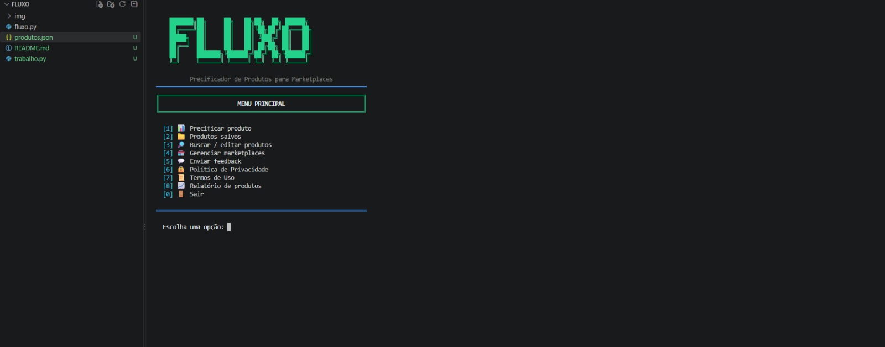
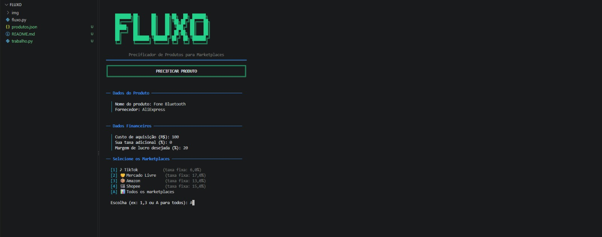
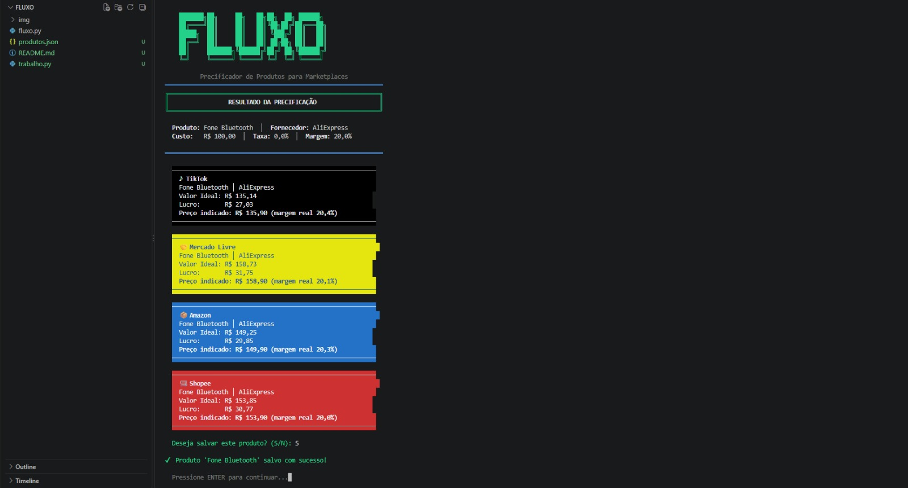

# FLUXO — Precificador de Produtos para Marketplaces

Sistema em **Python**, executado no **terminal**, que calcula o preço de venda de produtos para marketplaces (TikTok, Mercado Livre, Amazon, Shopee e outros cadastrados pelo próprio usuário), organiza os produtos em um catálogo e gera relatórios.

> Projeto Integrador (P.I.) do 2º período do curso de **Análise e Desenvolvimento de Sistemas** — IFBA, Campus Eunápolis. Entrega II (versão 2.0).

## Sumário

* [Sobre o projeto](#sobre-o-projeto)

* [Funcionalidades](#funcionalidades)

* [Como o preço é calculado](#como-o-preço-é-calculado)

* [Demonstração](#demonstração)

* [Requisitos](#requisitos)

* [Instalação e execução](#instalação-e-execução)

* [Guia rápido de uso](#guia-rápido-de-uso)

* [Marketplaces padrão](#marketplaces-padrão)

* [Arquivos do projeto](#arquivos-do-projeto)

* [Organização do código](#organização-do-código)

* [Validações e tratamento de erros](#validações-e-tratamento-de-erros)

* [Feedback](#feedback)

* [Solução de problemas](#solução-de-problemas)

* [Escopo e melhorias futuras](#escopo-e-melhorias-futuras)

* [Itens previstos e realizados](#itens-previstos-e-realizados)

* [Equipe e responsabilidades](#equipe-e-responsabilidades)

* [Linha do tempo](#linha-do-tempo)

* [Considerações gerais](#considerações-gerais)

* [Ferramentas utilizadas](#ferramentas-utilizadas)

* [Documentação](#documentação)

* [Instituição e orientação](#instituição-e-orientação)

## Sobre o projeto

Vender em marketplaces exige definir preços considerando o custo de aquisição, as taxas adicionais, as taxas cobradas por cada plataforma e a margem de lucro desejada. Fazer esse cálculo à mão, produto por produto e plataforma por plataforma, consome tempo e favorece erros que reduzem o lucro.

O **Fluxo** reúne o cálculo de preços e o registro dos produtos em um só lugar. Ele é voltado a MEIs (Microempreendedores Individuais) e a empresas de pequeno e médio porte que precisam organizar seus produtos e calcular preços de forma simples, mesmo com pouca familiaridade tecnológica.

Nesta versão o sistema é apresentado em terminal. A versão 100% online é um objetivo para as próximas etapas.

## Funcionalidades

**Núcleo do sistema**

* **Precificação** de um produto para um ou mais marketplaces, com preço ideal e lucro.

* **Catálogo de produtos**: cadastro, listagem, consulta, edição e exclusão com confirmação.

* **Marketplaces**: padrão e cadastrados pelo usuário, cada um com sua taxa.

**Diferenciais da versão 2.0** (acrescentados após a reunião de 18/11/2026 com o orientador)

| Funcionalidade | O que faz | 
| ----- | ----- | 
| **Preço indicado** | Sobe o preço ideal para o próximo valor terminado em `,90` e mostra a margem real nesse preço. | 
| **Busca e ordenação** | Busca por nome ou fornecedor, ignorando maiúsculas e acentos, com várias palavras em qualquer ordem. Lista por cadastro, nome, menor custo ou mais recentes. | 
| **Edição com prévia e histórico** | Mostra "antes → depois" e a prévia dos novos preços, pede confirmação e registra cada alteração no histórico do produto. | 
| **Edição da taxa de marketplace** | Altera a taxa de qualquer marketplace, com exemplo do efeito, e oferece recalcular os produtos salvos. | 
| **Recálculo de preços salvos** | Detecta preços desatualizados (taxa alterada, marketplace criado ou removido) e refaz os cálculos, com aviso no menu. | 
| **Relatório de produtos** | Resumo, tabela de todos os produtos e ranking por retorno, com exportação em **CSV** (Excel) e **HTML** (navegador ou PDF). | 
| **Feedback** | Envio da opinião do usuário por HTTPS, com notificação no Windows e cópia local quando não há internet. | 
| **Validação e proteção de dados** | Cada campo é validado na hora; arquivos de dados danificados são preservados e a gravação é feita em duas etapas. | 

## Como o preço é calculado

Para cada marketplace:

```
Preço ideal    = custo ÷ (1 − taxa do marketplace − taxa adicional − margem)
Lucro          = preço ideal × margem
Preço indicado = próximo valor terminado em ,90 igual ou acima do preço ideal

```

O **preço indicado** nunca fica abaixo do ideal, então a margem real é sempre igual ou maior que a desejada. Se a soma das taxas com a margem chegar a 100% ou mais, o cálculo é impossível naquele marketplace e o sistema avisa.

**Exemplo:** custo de R\$ 100,00, taxa adicional de 0%, margem de 20% e Shopee (taxa de 15%):

|  | Valor | 
| ----- | ----- | 
| Preço ideal | R\$ 153,85 | 
| Lucro | R\$ 30,77 | 
| Preço indicado | R\$ 153,90 (margem real de 20,0%) | 

> **Observação:** a taxa do marketplace é um **percentual** sobre o valor da venda. Tarifas fixas por item, frete e impostos não são considerados nesta versão (veja [Escopo e melhorias futuras](#escopo-e-melhorias-futuras)).

## Demonstração

### Menu principal


### Precificação de produto


### Resultado da precificação (cards coloridos por marketplace)


## Requisitos

* **Python 3.8 ou superior** (a equipe desenvolveu e testou na versão 3.14).

* Um terminal com suporte a cores e UTF-8: **Windows Terminal** ou o terminal integrado do **VS Code**.

* Nenhuma biblioteca externa é obrigatória: o sistema usa apenas a biblioteca padrão do Python.

* *Opcional:* `winotify`, para as notificações do Windows (`python -m pip install winotify`).

* *Opcional:* conexão com a internet, necessária apenas para enviar feedback.

## Instalação e execução

**1. Obter o código**

```
git clone https://github.com/phmcarvalho777/phmcarvalho777.github.io.git
cd phmcarvalho777.github.io

```

Também é possível baixar o repositório em ZIP pelo botão **Code** do GitHub. Se o arquivo principal estiver dentro de uma subpasta, entre nela antes de executar.

**2. Conferir o Python**

```
python --version

```

**3. Executar**

```
python fluxo.py

```

No Linux ou macOS, use `python3 fluxo.py`. As notificações do Windows não existem nesses sistemas, e o sistema continua funcionando normalmente.

**4. (Opcional) Instalar as notificações do Windows**

```
python -m pip install winotify

```

Na primeira execução, o sistema cria os arquivos de dados na mesma pasta do programa.

## Guia rápido de uso

Todas as opções são escolhidas digitando o número e pressionando `ENTER`.

| Opção | Tela | O que faz | 
| ----- | ----- | ----- | 
| `1` | Precificar produto | Pede nome, fornecedor, custo, taxa adicional e margem; mostra o preço de cada marketplace escolhido e permite salvar. | 
| `2` | Produtos salvos | Lista todos os produtos com os preços; permite excluir (com confirmação). | 
| `3` | Buscar / editar produtos | Busca, listagem ordenada, ficha do produto, edição com histórico, exclusão e recálculo de preços. | 
| `4` | Gerenciar marketplaces | Cadastrar, remover, restaurar os padrão, editar taxa e recalcular preços salvos. | 
| `5` | Enviar feedback | Envia nome (opcional), contato (opcional) e uma mensagem de até 500 caracteres. | 
| `6` e `7` | Privacidade e Termos | Telas informativas. | 
| `8` | Relatório de produtos | Resumo, tabela, ranking e exportação em CSV e HTML. | 
| `0` | Sair | Encerra o programa (`Ctrl+C` também encerra sem erro técnico). | 

**Fluxo típico**

1. Em `[1]`, informe o produto e escolha os marketplaces (`1,3` para alguns, ou `A` para todos).

2. Veja o preço ideal, o lucro e o preço indicado de cada um e salve o produto.

3. Em `[3]`, busque o produto, abra a ficha e edite o que precisar. Os preços são recalculados.

4. Em `[4]`, ajuste a taxa de um marketplace. O sistema avisa quais produtos ficaram desatualizados e oferece recalcular.

5. Em `[8]`, veja o relatório e exporte para CSV (Excel) e HTML.

**Regras dos campos de precificação**

| Campo | Regra | 
| ----- | ----- | 
| Nome do produto | Até 40 caracteres, obrigatório. | 
| Fornecedor | Até 30 caracteres, obrigatório. | 
| Custo de aquisição | Maior que zero. | 
| Taxa adicional | De 0% a 99%. | 
| Margem de lucro | De 0% a 99%. | 

Os números aceitam vírgula ou ponto, como `25,90` ou `1.234,56`. Se algum campo estiver errado, o sistema explica o problema e pede somente aquele campo de novo.

## Marketplaces padrão

| Marketplace | Taxa de referência | 
| ----- | ----- | 
| TikTok | 6% | 
| Mercado Livre | 17% | 
| Amazon | 13% | 
| Shopee | 15% | 

São **valores de referência**. As taxas reais variam por plataforma e mudam com o tempo, então o usuário pode editá-las em `[4] Gerenciar marketplaces` conforme as tabelas atuais de cada plataforma. Também é possível cadastrar novos marketplaces (nome de até 16 caracteres e taxa de 0% a 99%); sempre resta pelo menos um ativo.

## Arquivos do projeto

```
.
├── fluxo.py                    # programa principal (código-fonte)
├── README.md                   # este arquivo
├── .gitignore                  # impede o envio dos arquivos gerados abaixo
├── img/                        # capturas de tela usadas na demonstração
├── docs/                       # documentação e relato em PDF
│
├── produtos.json               # (gerado) produtos salvos
├── marketplaces.json           # (gerado) marketplaces cadastrados, removidos e taxas alteradas
├── feedbacks_pendentes.json    # (gerado) feedbacks que não puderam ser enviados
└── relatorios/                 # (gerado) relatórios exportados em CSV e HTML

```

Se um arquivo de produtos estiver danificado, o sistema o renomeia para `produtos_corrompido_AAAAMMDD_HHMMSS.json` e recomeça com a lista vazia, sem apagar nada.

## Organização do código

O código está em um único arquivo, dividido em quatro partes:

| Parte | Conteúdo | 
| ----- | ----- | 
| **1. Utilidades visuais** | Bordas, cores, formatação de moeda e percentual no padrão brasileiro, leitura e validação de entradas (`ler_texto`, `ler_numero`, `confirmar`). | 
| **2. Dados e armazenamento** | Carregar e salvar em JSON, buscar, ordenar, atualizar e excluir produtos; marketplaces. | 
| **3. Lógica de cálculo** | `calcular_preco`, `calcular_preco_indicado`, recálculo dos preços salvos, montagem e exportação do relatório. | 
| **4. Interface** | Menus e telas do terminal. | 

## Validações e tratamento de erros

* Cada campo digitado é validado na hora; valores inválidos (`nan`, `inf`, negativos, fora da faixa) são recusados e só aquele campo é pedido de novo.

* A escolha de marketplaces explica a opção inválida em vez de ignorá-la.

* Exclusões e alterações pedem confirmação (`S` ou `N`).

* Aviso quando já existe um produto com o mesmo nome e fornecedor.

* A gravação dos dados é feita em duas etapas (arquivo temporário e substituição), para não corromper o arquivo.

* Arquivo de dados danificado ou incompleto é preservado com outro nome, e o sistema continua funcionando.

* Falhas ao gravar relatórios ou ao enviar feedback geram mensagem clara, sem travar o programa.

* `Ctrl+C` e `Ctrl+D` encerram o programa sem mostrar erro técnico.

## Feedback

Na opção `[5]`, o usuário envia uma opinião (nome e contato opcionais, mensagem de até 500 caracteres).

* O envio é feito por **HTTPS**, por meio do serviço **Formspree**, que encaminha a mensagem ao e-mail do grupo.

* No Windows, uma **notificação** informa se o envio deu certo ou falhou.

* Sem internet, a mensagem é guardada em `feedbacks_pendentes.json`.

* Para usar outro formulário, defina a variável de ambiente `FLUXO_WEBHOOK_URL` com o endereço do novo formulário.

> O envio por e-mail (SMTP) foi tentado primeiro, mas a conexão era bloqueada por rede ou antivírus. Por isso o grupo passou a usar HTTPS.

## Solução de problemas

| Problema | O que fazer | 
| ----- | ----- | 
| `python` não é reconhecido | Reinstale o Python marcando **Add Python to PATH**, ou use `py fluxo.py`. | 
| Feedback não é enviado | Verifique a internet e se há bloqueio de rede ou antivírus. A mensagem fica salva em `feedbacks_pendentes.json`. | 
| Acentos ou cores estranhos | Use o Windows Terminal ou o terminal do VS Code. | 
| Arquivo de produtos danificado | O sistema o preserva como `produtos_corrompido_*.json` e recomeça com a lista vazia. | 
| Sem notificação do Windows | Instale a biblioteca opcional: `python -m pip install winotify`. | 

## Escopo e melhorias futuras

**Fora do escopo desta versão** (decisão registrada na documentação):

* Versão 100% online (web).

* Integrações avançadas com sistemas externos (ERP, CRM, nuvem).

* Ferramentas complexas de gerenciamento (Gantt, Kanban avançado, dashboards customizáveis).

* Recursos de inteligência artificial avançada.

* Login, cadastro de usuários e perfil de administrador: o Fluxo é de uso individual e local.

* Outros custos de venda: tarifas fixas por item, frete e impostos.

**Melhorias futuras**

* Disponibilizar o Fluxo como sistema 100% online e evoluir a interface.

* Incluir no cálculo as tarifas fixas por item, o frete e os impostos.

* Incluir login e perfil de administrador, com gestão de usuários e indicadores de uso.

* Exportar o relatório diretamente em PDF.

* Criar testes automatizados para o cálculo e para as validações.

* Avaliar integrações com sistemas externos.

## Itens previstos e realizados

Resumo da tabela do **Relato de Condução** (itens marcados com *diferencial* foram acrescentados após a reunião de 18/11/2026 e não faziam parte do escopo originalmente aprovado).

| Item previsto | Realizado? | Considerações | 
| ----- | ----- | ----- | 
| Protótipo das telas no Figma | Sim | Novo Figma criado em 12/08/2026. | 
| Ícones de dúvida | Parcial | Feitos na versão web inicial; no terminal viraram textos de orientação em cada tela. | 
| Versão inicial em HTML/CSS e transcrição para Python | Sim | Transcrito para Python em 02/11/2026. | 
| Acesso com login (e-mail e senha) | Não | Movido para melhorias futuras: a versão 2.0 é de uso individual e local. | 
| Cadastro de produtos | Sim | Opção `[1]`, com validação e aviso de duplicidade. | 
| Visualizar e consultar produtos | Sim | Opções `[2]` e `[3]`, com busca e ordenação. | 
| Editar produtos | Sim | *Diferencial:* prévia "antes → depois" e histórico. | 
| Excluir produtos com confirmação | Sim | Opções `[2]` e `[3]`, sempre com `S` ou `N`. | 
| Cálculo do preço de venda por marketplace | Sim | Considera só taxas percentuais. | 
| Gerenciar marketplaces e taxas | Sim | *Diferencial.* Opção `[4]`. | 
| Feedback do usuário | Sim | *Diferencial.* HTTPS, notificação no Windows e backup offline. | 
| Administrador: gestão de usuários | Não | Adiado: o sistema não tem cadastro de usuários. | 
| Indicadores de uso | Parcial | O relatório mostra totais e marketplace mais competitivo, sem "usuários ativos". | 
| Relatórios administrativos com base nos feedbacks | Parcial | Os feedbacks chegam por e-mail; há o relatório de produtos. | 
| Preço indicado | Sim | *Diferencial.* | 
| Recálculo de preços salvos | Sim | *Diferencial.* | 
| Relatório de produtos | Sim | *Diferencial.* Opção `[8]`, em CSV e HTML. | 
| Validação de entradas e tratamento de erros | Sim | Veja [Validações e tratamento de erros](#validações-e-tratamento-de-erros). | 
| Documentação do sistema | Sim | Versão 2.0, em PDF. | 
| Repositório no GitHub (commits da equipe e README) | Sim | Este repositório. | 

## Equipe e responsabilidades

| Integrante | Atuações | 
| ----- | ----- | 
| **Aquiles Santos Almeida** (ASA) | **Parte 3** (lógica de cálculo e precificação por marketplace): preço ideal e lucro a partir do custo, das taxas e da margem, com regras para evitar cálculos inviáveis. Atualização do código para a finalização, com Emerson. | 
| **Emerson Conceição Silva** (ECS) | **Parte 2** (dados e armazenamento em JSON): carregamento, gravação segura, adição, busca, ordenação, atualização e exclusão de produtos, e validação da integridade dos registros. Ícones de dúvida, Figma (com Pedro) e atualização do código (com Aquiles). | 
| **Kaleo Davi Lopes Assunção** (KDLA) | **Parte 4** (interface no terminal): menu principal, fluxos de interação e cartões coloridos por marketplace. Documentação das apresentações, levantamento de requisitos e transcrição do código para Python (com Pedro). | 
| **Pedro Henrique Miranda Carvalho** (PHMC) | **Parte 1** (utilidades visuais e padronização): cabeçalhos, bordas, cores, formatação no padrão brasileiro e funções de leitura e validação de entradas. Figma (com Emerson) e transcrição do código para Python (com Kaleo). | 

A correção de bugs, a otimização do código, a definição da aparência no terminal, a documentação final e o relato de condução foram feitos pelo grupo.

## Linha do tempo

| Data | Atuação | 
| ----- | ----- | 
| 17/07/2026 | Atualização do sistema: ícones de dúvida | 
| 12/08/2026 | Novo Figma para a apresentação | 
| 07/09/2026 | Correção de bugs e otimização do código | 
| 10/09/2026 | Reunião com o orientador sobre a apresentação | 
| 15/09/2026 | Levantamento de requisitos | 
| 24/09/2026 | Apresentação do P.I | 
| 14/10/2026 | Atualização do código para a finalização | 
| 02/11/2026 | Transcrição do código de HTML/CSS para Python | 
| 08/11/2026 | Definição da aparência da apresentação no terminal | 
| 14/11/2026 | Primeira versão da documentação | 
| 17/11/2026 | Reunião via Google Meet: alinhamento e organização do repositório | 
| 18/11/2026 | Primeira versão do relato de condução; reunião com o orientador para alinhamento da entrega final | 
| 19/11/2026 | Definição e início das novas funcionalidades | 
| 20/11/2026 | Conclusão das funcionalidades, do código e da documentação (versão 2.0) | 
| 21/11/2026 | Relato de condução (versão final) | 

## Considerações gerais

O Fluxo cumpriu o objetivo de reunir, em um só lugar, o cálculo do preço de venda e o cadastro de produtos para marketplaces. Nesta etapa, o sistema recebeu a busca e a edição de produtos com histórico, o gerenciamento de marketplaces com edição de taxas, o preço indicado, o recálculo de preços salvos, o relatório em CSV e HTML e o envio de feedback, além de validação dos dados e tratamento de erros.

Os principais desafios foram a mudança de tecnologia de HTML/CSS para Python, o bloqueio do envio de feedback por e-mail (resolvido com o envio por HTTPS) e a manutenção dos preços corretos quando as taxas mudam (resolvida com a detecção e o recálculo). O trabalho foi dividido em partes entre os integrantes, e as dificuldades foram resolvidas em equipe, com versionamento no Git e no GitHub e prazos curtos.

Ficaram como melhorias futuras: incluir no cálculo as tarifas fixas por item, o frete e os impostos; criar login e perfil de administrador; e disponibilizar o sistema 100% online. Esta foi a primeira experiência da equipe com um projeto desse porte: foi difícil, mas também uma grande experiência de aprendizado.

## Ferramentas utilizadas

* **Python 3** (somente biblioteca padrão), **VS Code** e **Git/GitHub**.

* **Figma**, para a prototipação das telas.

* **Formspree**, para o envio do feedback por HTTPS.

* **winotify** (opcional), para as notificações do Windows.

* **Apoio de inteligência artificial:** o grupo usou uma ferramenta de IA generativa (Claude, da Anthropic) como apoio na escrita, na revisão e nos testes do código e na revisão dos textos da documentação. O grupo definiu os requisitos, tomou as decisões do projeto, testou o sistema e responde pelo resultado final.

## Documentação

Os documentos do projeto ficam na pasta [`docs/`](docs/):

* Documentação do sistema (versão 2.0): `docs/Documentacao_Fluxo.pdf`

* Relato de condução: `docs/Relato_de_Conducao_Fluxo.pdf`

## Instituição e orientação

* **Instituição:** Instituto Federal da Bahia (IFBA) — Campus Eunápolis

* **Curso:** Análise e Desenvolvimento de Sistemas, 2º período

* Alunos: Aquiles Santos Almeida, Emerson Conceição Silva, Kaleo Davi Lopes Assunção, Pedro Henrique Miranda Carvalho**.** 

* **Orientação:** Professor Vinicius

* **Ano:** 2026

Projeto acadêmico desenvolvido para fins educacionais.